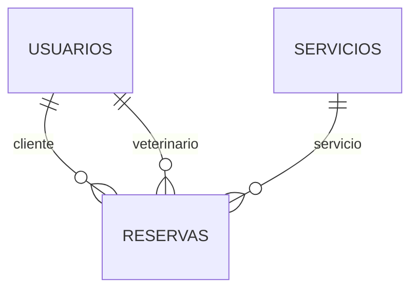

# Cómo funciona VetCitas paso a paso

El sistema tiene dos partes. El navegador muestra formularios y tablas; Spring Boot recibe solicitudes, comprueba permisos y guarda datos en MySQL. Los comentarios del código explican las piezas de cada parte.

## Sigue una reserva desde el clic hasta MySQL

1. Abres el panel cliente y pulsas **Nueva cita**. `static/js/panel.js`, en `editarReserva`, crea el formulario con los servicios y veterinarios leídos del servidor.
2. Al guardar, `api.js` solicita `/api/auth/csrf`. El token prueba que el formulario tiene acceso a la sesión. Después envía un `POST /api/reservas` con JSON. La cookie `JSESSIONID` identifica tu sesión.
3. `SecurityConfig` comprueba autenticación y CSRF. `ActualizarSesionFilter` vuelve a consultar la cuenta, para detectar si un administrador la desactivó o cambió su rol.
4. `ReservaController.crear` recibe los datos. `@RequestBody` convierte JSON a `ReservaRequest`; `@Valid` ejecuta restricciones como `@NotBlank`, `@NotNull` y `@Positive`.
5. `@AuthenticationPrincipal` entrega la identidad comprobada. No se confía en un rol enviado por el navegador.
6. `ReservaService.crear` aplica las reglas: cliente correcto, fecha futura, recursos activos y profesional disponible. `@Transactional` agrupa las operaciones de base de datos.
7. `UsuarioRepository.bloquearPorId` bloquea temporalmente al veterinario. `ReservaRepository.contarCruces` busca citas con intervalos superpuestos. READ_COMMITTED permite ver reservas confirmadas por otras transacciones después de esperar el bloqueo.
8. `reservas.save` utiliza JPA/Hibernate para ejecutar el `INSERT` en MySQL. Las claves foráneas enlazan las tablas.
9. El servicio construye `ReservaResponse`. El controlador responde `201 Created`, con JSON y una cabecera `Location`.
10. El navegador vuelve a consultar la lista y muestra la cita guardada. Si reinicias el servidor, el registro sigue en MySQL.

## Qué significa CRUD

| Letra | Acción | HTTP | Ejemplo de código |
|---|---|---|---|
| C — Create | Crear | POST | `servicios.save(nuevoServicio)` |
| R — Read | Leer | GET | `servicios.findById(id)` |
| U — Update | Actualizar | PUT | Buscar, cambiar atributos y guardar |
| D — Delete | Eliminar | DELETE | `servicios.delete(servicio)` |

PATCH permite modificar una parte concreta, como el estado de una cita. Es distinto de PUT, que recibe los datos editables completos del recurso.

## Para qué sirve cada capa

**Controller:** decide qué método Java responde a una URL. No debería escribir SQL ni calcular reglas de citas.

**DTO:** significa objeto de transferencia de datos. Define qué puede enviarse y qué puede devolverse. Por ejemplo, `PerfilRequest` no tiene rol, por lo que editar el perfil no permite convertirse en administrador. `UsuarioResponse` no contiene password.

**Service:** aplica las reglas del negocio y decide si una operación puede completarse. Aquí se comprueba un correo repetido, un horario ocupado o un borrado que rompería el historial.

**Repository:** comunica el servicio con la base. `JpaRepository<Servicio, Long>` indica que trabaja con servicios cuyo identificador es Long. Hereda operaciones comunes y permite añadir consultas.

**Entity:** representa una tabla. `@Entity` la registra en JPA; `@Id` marca su clave primaria; `@GeneratedValue` pide que MySQL genere el ID. `@ManyToOne` enlaza muchas reservas con un cliente y `@OneToMany` representa la dirección inversa.

## Conceptos Java usados

- Un atributo `private` se lee o modifica mediante getters/setters. Las entidades los tienen escritos explícitamente para que puedas seguirlos sin aprender Lombok.
- Un `record` crea un DTO inmutable: por ejemplo, `r.nombre()` devuelve el nombre, sin necesitar escribir un getter. Está disponible en Java 17.
- Un `enum` limita los valores aceptados, como `Rol.ADMIN` o `EstadoReserva.PENDIENTE`.
- `Optional` puede contener o no un resultado. `orElseThrow` produce un error claro si no se encontró la fila.
- `stream().map(...).toList()` transforma una lista, por ejemplo de entidades a DTOs.
- `var` deja que Java deduzca el tipo de una variable local. Sigue siendo un lenguaje con tipos; no significa que el valor pueda cambiar de tipo.
- Una excepción interrumpe la operación. `GlobalExceptionHandler` transforma las excepciones esperadas en errores HTTP legibles.

## Inyección de dependencias

El constructor de `ReservaService` recibe sus repositorios. Spring ya los creó y los entrega automáticamente. Eso es inyección por constructor: el servicio declara qué necesita y no crea manualmente cada dependencia. Los atributos `final` no pueden apuntar después a otro objeto.

`@Service`, `@RestController` y `@Configuration` permiten a Spring descubrir componentes. `@Bean` registra objetos construidos con métodos, como `PasswordEncoder`. No hace falta `@Autowired` cuando una clase tiene un solo constructor.

## Relaciones y consultas

Una relación LAZY se carga cuando se necesita. Se construyen los DTOs dentro de la transacción para leer esas relaciones sin dejar consultas abiertas durante la respuesta HTTP. Por eso `spring.jpa.open-in-view=false`.

JPQL consulta objetos Java: `select s from Servicio s where ...`. SQL consulta tablas: `SELECT * FROM servicios WHERE ...`. En ambos casos se puede buscar por nombre, pero JPQL permite a Hibernate traducir la consulta al dialecto de la base. Los parámetros evitan concatenar texto recibido del usuario en las consultas.

`@Version` detecta dos actualizaciones simultáneas sobre una reserva. El bloqueo pesimista de la fila del veterinario resuelve otro problema: dos citas nuevas que intentan ocupar el mismo horario.

## Contraseñas y sesiones

BCrypt es **hash**, no cifrado reversible. Al registrarte se guarda un hash con salt. En el login, Spring compara la contraseña introducida con ese hash. La API no devuelve la contraseña ni el hash.

La sesión se guarda en el servidor. El navegador solo conserva una cookie con el identificador. Al iniciar sesión se cambia ese identificador y se guarda explícitamente el contexto de Spring Security. Al salir se invalida la sesión. Los permisos no dependen de ocultar botones.

CSRF protege formularios con sesión frente a peticiones de otros sitios. El token se solicita antes de las operaciones que cambian datos. Frontend y backend se sirven desde el mismo origen; por ello no se necesita habilitar CORS global ni permitir orígenes indiscriminadamente.

## Cómo aprender modificándolo

Prueba primero cambiar la descripción de un servicio desde la interfaz y comprueba el cambio en Workbench. Después busca `ServicioController.actualizar`, sigue la llamada al servicio y observa `save`. Repite el recorrido con una creación y un borrado.

Para agregar un campo en el futuro, considera la entidad, los DTOs, el mapeo del servicio, el formulario y el esquema SQL. Los cambios de autorización se hacen en el servidor y se comprueban con pruebas de integración.

Documentación consultada: [sesiones de Spring Security](https://docs.spring.io/spring-security/reference/servlet/authentication/session-management.html), [protección CSRF](https://docs.spring.io/spring-security/reference/servlet/exploits/csrf.html) y [Maven Wrapper](https://maven.apache.org/tools/wrapper/index.html).
